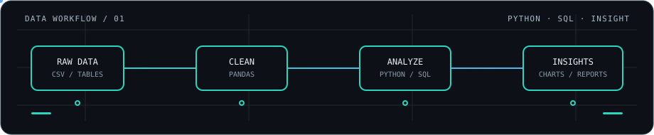
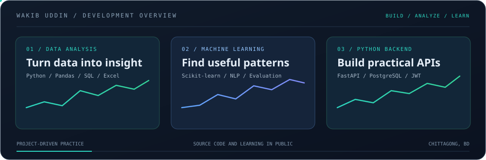

<h1 align="center">Hi, I'm Wakib Uddin</h1>

  

## About Me

I'm a Computer Science & Engineering graduate from **Premier University, Chattogram, Bangladesh**. My career goal is to grow as a **Data Analyst**, using Python, SQL and Excel to turn raw data into clear findings and useful visualizations.

I am building my skills through hands-on projects in data preparation, exploratory analysis, machine learning and Python backend development.

- 📊 Interested in data cleaning, exploratory data analysis (EDA), reporting and visualization
- 🐍 Working with Python, Pandas, NumPy and Matplotlib
- 🧮 Practising data handling and reporting with Advanced Excel
- 🗄️ Using SQL and PostgreSQL in database-backed projects
- 🤖 Exploring supervised machine learning with scikit-learn

## Skills & Tools

  
  
  
  
  
  
  
  
  

## Featured Projects

  SELECTED WORK · DATA ANALYSIS · MACHINE LEARNING · BACKEND DEVELOPMENT

<table>
  <tr>
    <td width="50%" valign="top">
      <h3>01 · Data Analysis Pipeline</h3>
      
Explore a dataset through cleaning, missing-value checks, duplicate handling, descriptive statistics, KPI summaries and visual reports.

      
   

      <a href="https://github.com/Wakib-Uddin/Data-Analysis-Dashboard">VIEW REPOSITORY ↗</a>
    </td>
    <td width="50%" valign="top">
      <h3>02 · Network Intrusion Detection</h3>
      
Machine-learning classification project focused on preprocessing network data and evaluating a Random Forest model.

      
  

      <a href="https://github.com/Wakib-Uddin/Network-Intrusion-Detection">VIEW REPOSITORY ↗</a>
    </td>
  </tr>
  <tr>
    <td width="50%" valign="top">
      <h3>03 · Spam Email Classifier</h3>
      
Text classification using TF-IDF features with Logistic Regression and Multinomial Naive Bayes.

      
  

      <a href="https://github.com/Wakib-Uddin/Spam-Email-Classifier">VIEW REPOSITORY ↗</a>
    </td>
    <td width="50%" valign="top">
      <h3>04 · Movie Recommendation API</h3>
      
Content-based movie recommendations using TF-IDF and cosine similarity, made available through a FastAPI endpoint.

      
  

      <a href="https://github.com/Wakib-Uddin/Movie-Recommendation-API">VIEW REPOSITORY ↗</a>
    </td>
  </tr>
  <tr>
    <td width="50%" valign="top">
      <h3>05 · E-Commerce REST API</h3>
      
Backend project covering API routes, database-backed products and orders, and JWT authentication.

      
  

      <a href="https://github.com/Wakib-Uddin/E-Commerce-REST-API">VIEW REPOSITORY ↗</a>
    </td>
    <td width="50%" valign="top">
      <h3>06 · Expense Tracker CLI</h3>
      
Python command-line application with JSON persistence, input validation and unit tests.

      
  

      <a href="https://github.com/Wakib-Uddin/Expanse-Tracker">VIEW REPOSITORY ↗</a>
    </td>
  </tr>
</table>

## GitHub Overview

  

**How I work:** explore a problem, prepare the data, build a solution, evaluate the result and document what I learn.

## Current Learning Goals

- Strengthen SQL: joins, aggregations, subqueries and window functions
- Practise end-to-end exploratory data analysis on real-world datasets
- Build clear, decision-focused charts and reports
- Improve Excel analysis and reporting workflows
- Develop a portfolio of documented data projects with reproducible results

## Connect With Me

- **LinkedIn:** [Wakib Uddin Safi](https://www.linkedin.com/in/wakib-uddin-safi-1475902a0/)
- **GitHub:** [Wakib-Uddin](https://github.com/Wakib-Uddin)
- **Portfolio:** [Portfolio repository](https://github.com/Wakib-Uddin/Portfolio)
- **Location:** Chattogram, Bangladesh

*Learning from data. Building with purpose.*

DATA CURIOUS · PYTHON POWERED · ALWAYS LEARNING

