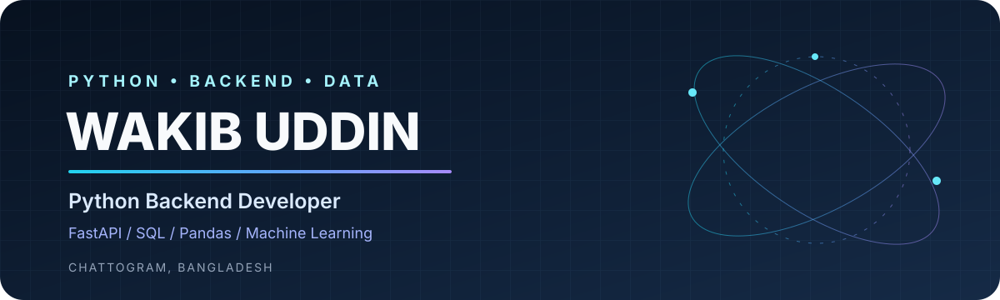

## 👋 About Me

I'm a Computer Science & Engineering graduate from **Premier University, Chattogram, Bangladesh**, focused on Python backend development and practical data projects.

- 🐍 Building with Python and FastAPI
- 🗄️ Applying SQL and PostgreSQL in backend projects
- 📊 Working with Pandas, NumPy and data visualization
- 🤖 Exploring machine-learning workflows with scikit-learn
- 🧪 Improving project quality through testing, documentation and reproducible workflows

## 🧰 Tech Stack

  

  
  
  
  

## 🚀 Featured Projects

<table>
<tr>
<td width="50%" valign="top">

### 🛒 E-Commerce REST API
FastAPI backend with SQLAlchemy, PostgreSQL, JWT authentication, product and order workflows.

**Stack:** Python · FastAPI · SQLAlchemy · PostgreSQL

<a href="https://github.com/Wakib-Uddin/E-Commerce-REST-API">View repository →</a>
</td>
<td width="50%" valign="top">

### 🛡️ Network Intrusion Detection
Machine-learning pipeline for structured network traffic: preprocessing, Random Forest and classification metrics.

**Stack:** Python · Pandas · Scikit-learn · Matplotlib

<a href="https://github.com/Wakib-Uddin/Network-Intrusion-Detection">View repository →</a>
</td>
</tr>
<tr>
<td width="50%" valign="top">

### 🤖 Spam Email Classifier
NLP workflow using TF-IDF with Logistic Regression and Multinomial Naive Bayes.

**Stack:** Python · NLP · Scikit-learn

<a href="https://github.com/Wakib-Uddin/Spam-Email-Classifier">View repository →</a>
</td>
<td width="50%" valign="top">

### 🎬 Movie Recommendation API
Content-based recommendation service using TF-IDF, cosine similarity and FastAPI.

**Stack:** Python · FastAPI · Pandas · Scikit-learn

<a href="https://github.com/Wakib-Uddin/Movie-Recommendation-API">View repository →</a>
</td>
</tr>
<tr>
<td width="50%" valign="top">

### 📊 Data Analysis Pipeline
CSV cleaning, data-quality checks, KPIs, descriptive statistics and visual reports.

**Stack:** Python · Pandas · NumPy · Matplotlib

<a href="https://github.com/Wakib-Uddin/Data-Analysis-Dashboard">View repository →</a>
</td>
<td width="50%" valign="top">

### 💰 Expense Tracker CLI
Command-line spending tracker with JSON persistence, input validation and unit tests.

**Stack:** Python · argparse · unittest

<a href="https://github.com/Wakib-Uddin/Expanse-Tracker">View repository →</a>
</td>
</tr>
</table>

## 📈 GitHub at a Glance

  
  
   
  

## 🧭 Current Focus

- Build and test reliable FastAPI services
- Strengthen database design, SQL and PostgreSQL skills
- Improve ML projects with suitable datasets, reproducible evaluation and model persistence
- Add CI workflows, deployment guides and clear project demos

## 🤝 Let's Connect

- **LinkedIn:** [Wakib Uddin Safi](https://www.linkedin.com/in/wakib-uddin-safi-1475902a0/)
- **Portfolio source:** [Wakib-Uddin/Portfolio](https://github.com/Wakib-Uddin/Portfolio)
- **YouTube:** [Tech With Binary](https://youtube.com/@techwithbinary)
- **Location:** Chattogram, Bangladesh

*Build thoughtfully. Learn continuously. Ship useful things.*

