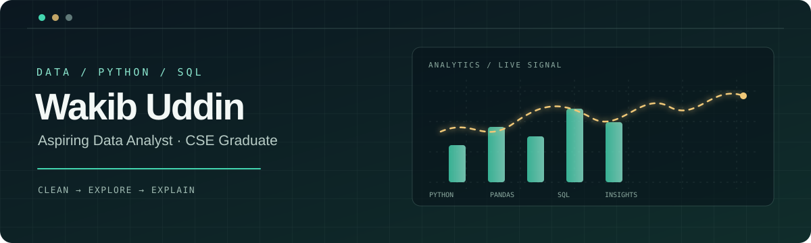

## About Me

I'm a Computer Science & Engineering graduate from **Premier University, Chattogram, Bangladesh**. My career goal is to grow as a **Data Analyst**, using Python, SQL and Excel to turn raw data into clear findings and useful visualizations.

I am building my skills through hands-on projects in data preparation, exploratory analysis, machine learning and Python backend development.

- 📊 Interested in data cleaning, exploratory data analysis (EDA), reporting and visualization
- 🐍 Working with Python, Pandas, NumPy and Matplotlib
- 🧮 Practising data handling and reporting with Advanced Excel
- 🗄️ Using SQL and PostgreSQL in database-backed projects
- 🤖 Exploring supervised machine learning with scikit-learn

## Skills & Tools

  
  
  
  
  
  
  
  
  

## Featured Projects

| Project | What it demonstrates |
|---|---|
| [Data Analysis Pipeline](https://github.com/Wakib-Uddin/Data-Analysis-Dashboard) | CSV loading, missing-value checks, duplicate handling, descriptive statistics, basic KPIs and visual reports using Pandas, NumPy and Matplotlib. |
| [Network Intrusion Detection](https://github.com/Wakib-Uddin/Network-Intrusion-Detection) | Data preprocessing, numeric/categorical feature handling, Random Forest classification, precision, recall, F1-score and confusion matrix. |
| [Spam Email Classifier](https://github.com/Wakib-Uddin/Spam-Email-Classifier) | Text preprocessing, TF-IDF features and supervised classification with Logistic Regression and Multinomial Naive Bayes. |
| [Movie Recommendation API](https://github.com/Wakib-Uddin/Movie-Recommendation-API) | Content-based recommendations using TF-IDF and cosine similarity, exposed through a FastAPI endpoint. |
| [E-Commerce REST API](https://github.com/Wakib-Uddin/E-Commerce-REST-API) | Backend engineering with FastAPI, SQLAlchemy, PostgreSQL and JWT authentication. |
| [Expense Tracker CLI](https://github.com/Wakib-Uddin/Expanse-Tracker) | Python command-line application with JSON persistence, validation and unit tests. |

## GitHub Overview

I keep my work public so you can explore the source code, project documentation and development history.

- **Repositories:** [Browse all my projects](https://github.com/Wakib-Uddin?tab=repositories)
- **Contributions:** [View my GitHub contribution calendar](https://github.com/Wakib-Uddin)
- **Pinned work:** See the featured Data Analysis, Machine Learning and Python Backend projects above.

> GitHub displays the live contribution calendar directly on my profile. This section intentionally avoids third-party statistics images that may fail to load.
  
## Current Learning Goals

- Strengthen SQL: joins, aggregations, subqueries and window functions
- Practise end-to-end exploratory data analysis on real-world datasets
- Build clear, decision-focused charts and reports
- Improve Excel analysis and reporting workflows
- Develop a portfolio of documented data projects with reproducible results

## Connect With Me

- **LinkedIn:** [Wakib Uddin Safi](https://www.linkedin.com/in/wakib-uddin-safi-1475902a0/)
- **GitHub:** [Wakib-Uddin](https://github.com/Wakib-Uddin)
- **Portfolio:** [Portfolio repository](https://github.com/Wakib-Uddin/Portfolio)
- **Location:** Chattogram, Bangladesh

*Learning from data. Building with purpose.*

DATA CURIOUS · PYTHON POWERED · ALWAYS LEARNING

